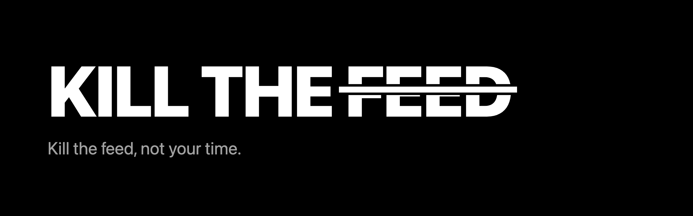
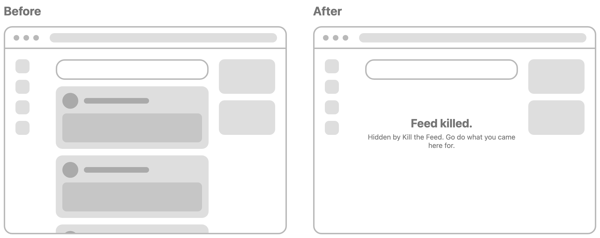
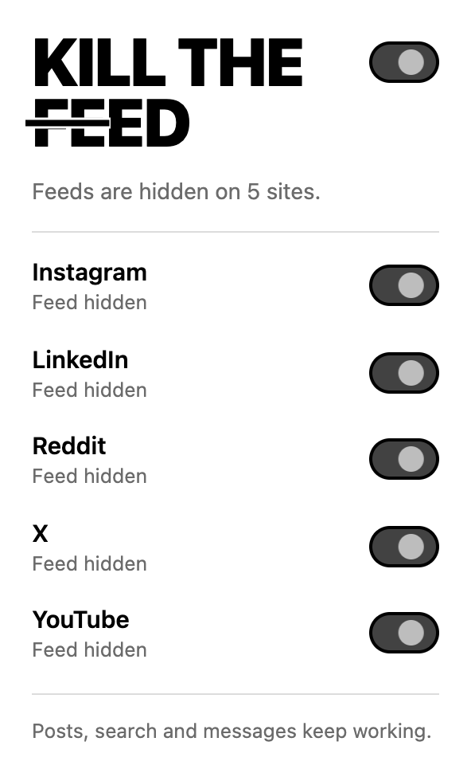
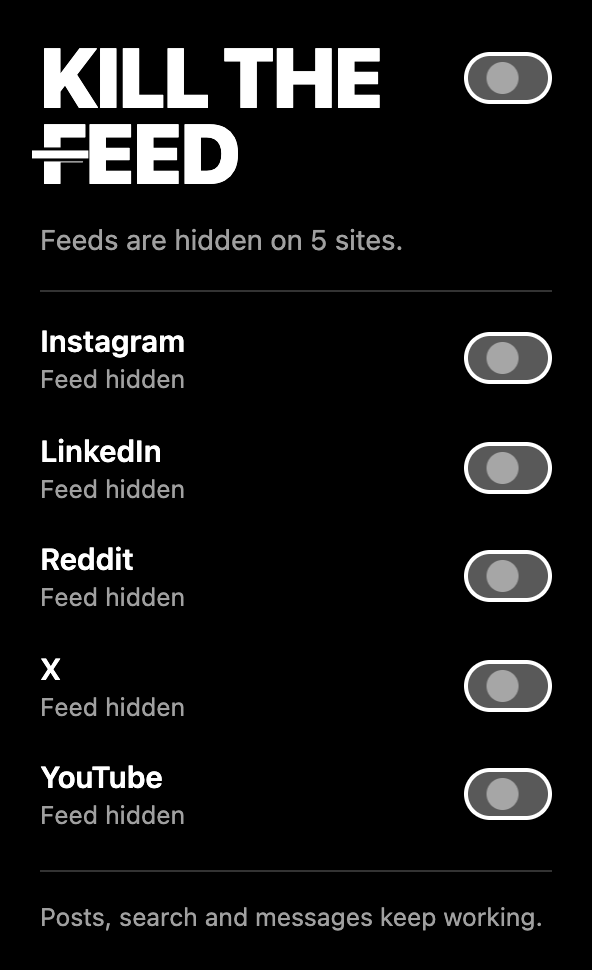

  

**Kill the Feed** is a free browser extension for people who open Reddit,
LinkedIn, X, YouTube or Instagram to do one thing and surface forty minutes
later. It takes the endless feed away. Everything you open on purpose still
works: the post someone sent you, search, your messages, writing.

  

No account. No tracking. No ads. The code is open.

## Install it in two minutes

You don't need to know anything about computers for this.

1. **Download** [kill-the-feed.zip](https://github.com/geraldreimertz/killthefeed/releases/latest/download/kill-the-feed.zip).
2. **Unzip it.** On a Mac, double-click the file. On Windows, right-click it and
   choose **Extract All**. You get a folder named `kill-the-feed`. Move it
   somewhere it can stay, for example into your Documents. Chrome keeps using
   this folder, so don't delete it afterwards.
3. **Open Chrome's extensions page.** Type `chrome://extensions` into the
   address bar and press Enter.
4. **Switch on "Developer mode".** It is the switch in the top right corner.
5. **Click "Load unpacked"** in the top left and choose the `kill-the-feed`
   folder.
6. **Reload** the Reddit, LinkedIn, X, YouTube or Instagram tabs you had open.

Done. Open one of the sites and the feed is gone.

To keep the button in view, click the puzzle piece in Chrome's toolbar and pin
Kill the Feed.

Good to know

- **Developer mode** is needed because the extension is not in the Chrome Web
  Store. Chrome may remind you now and then that you are running an extension
  in developer mode. That is expected for extensions installed this way.
- **Updates** don't arrive by themselves. To update, download the zip again,
  replace the old folder with the new one, and click the round arrow on the
  Kill the Feed card at `chrome://extensions`.
- **Other browsers.** It is built and tested for Chrome. Edge, Brave, Arc and
  other browsers built on Chrome load extensions the same way and should work.
- **Phones.** Desktop only.

## What goes, what stays

| Site      | What goes                                             | What stays                                                   |
| --------- | ----------------------------------------------------- | ------------------------------------------------------------ |
| Instagram | Stories and posts on the start page                   | Single posts and reels, profiles, search, messages           |
| LinkedIn  | The feed on the start page                            | Writing a post, single posts, profiles, search, messages     |
| Reddit    | Home, Popular, All, News                              | Communities, single posts, search, profiles                  |
| X         | Home timeline, Explore, news and trends at the side   | Writing a post, single posts, profiles, search, messages     |
| YouTube   | Recommendations on the start page and next to a video | The video itself, subscriptions, channels, search, playlists |

The rule of thumb: a feed is a stream that greets you without being asked.
A page you go to on purpose is not.

Not covered yet: YouTube Shorts, Instagram Reels and Instagram Explore.

## One switch per site

  
  

Click the Kill the Feed button in Chrome's toolbar. Each site has its own
switch, and the switch at the top pauses everything. A change takes effect at
once, without reloading the page.

## Privacy

Kill the Feed collects nothing.

- It makes no network requests. Nothing you do leaves your browser.
- No analytics, no tracking, no ads, no account.
- The only thing it stores is which switches you flipped, in Chrome's own
  storage.

When you install it, Chrome says the extension can read and change data on the
sites listed above. Every extension that hides part of a page needs that
permission. Kill the Feed uses it to hide feeds and for nothing else.

You don't have to take this on trust. Automated tests fail as soon as someone
adds code that could send data anywhere: one
[reads the code](test/unit/privacy.test.js), another
[watches the finished extension in a real browser](test/e2e/extension.test.js).
The details are in [PRIVACY.md](PRIVACY.md).

## Questions

**Is it really free?**
Yes. There is no paid version and there are no ads.

**A feed is back. What now?**
Sites change their pages, and then a feed can slip through.
[Tell us](https://github.com/geraldreimertz/killthefeed/issues/new/choose) which
site and which page. The fix is usually one line.

**Can you add another site?**
Probably. [Ask for it](https://github.com/geraldreimertz/killthefeed/issues/new/choose),
or add it yourself: every site is one small file.
[CONTRIBUTING.md](CONTRIBUTING.md) shows how.

**How do I get my feed back for a moment?**
Open the panel and flip the switch for that site, or the main switch at the
top.

**How do I remove it?**
At `chrome://extensions`, click **Remove** on the Kill the Feed card, then
delete the folder.

## Made by

Gerald Reimertz

- Website: [dorweiler-reimertz.com](https://www.dorweiler-reimertz.com/)
- YouTube: [youtube.com/geraldreimertz](https://www.youtube.com/geraldreimertz)
- X: [@geraldreimertz](https://x.com/geraldreimertz)

## For developers

How it works, the format of the filter lists, how to add a site and how to
build and test: [CONTRIBUTING.md](CONTRIBUTING.md).
